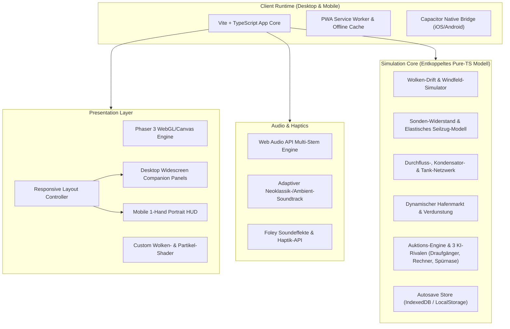
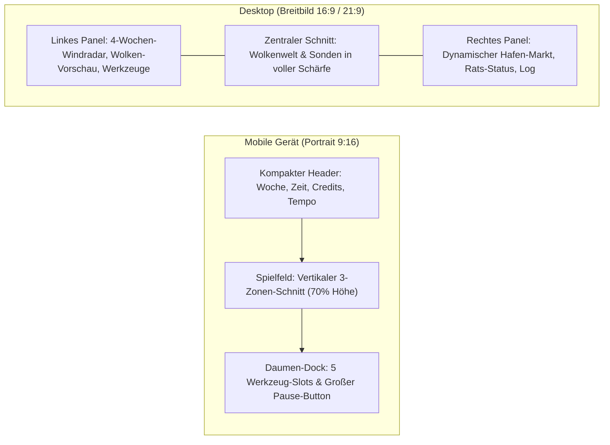
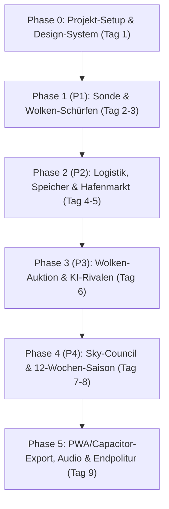

# Cloud Harvesters – Detaillierter Implementierungsplan

**Version:** 1.0.0  
**Datum:** 13. November 2026  
**Basis:** [game-plan.md](game-plan.md)  
**Status:** Freigegeben zur Umsetzung  

---

## 1. Executive Summary & Architekturbild

*Cloud Harvesters* überträgt den fesselnden Explorations- und Optimierungszyklus von *Turmoil* in den Himmel: Schürfen in driftenden Wolkenbändern, elastisches Sondieren von Kondensattaschen, Aufbau eines autarken Rohr- und Speicher-Logistiknetzes und strategische Versteigerungen im Sky-Council.

Dieses Dokument definiert die technische Architektur und den stufenweisen Entwicklungsplan für eine plattformübergreifende **HTML5-Lösung** (Desktop-Web & Mobile-App), umgesetzt mit modernsten Web-Standards und maximaler ästhetischer Güte.



---

## 2. Technologie-Stack & Projektstruktur

### 2.1 Core Stack
- **Game Engine:** `Phaser 3` (v3.85+) – WebGL-Rendering mit automatischem Canvas-Fallback, hochentwickelte Partikelsysteme, Tweens und native Touch-/Pointer-Gesten.
- **Language & Tooling:** `TypeScript 5.x` + `Vite` – Blitzschneller HMR, strikte Typisierung für die Simulationslogik und optimierte Tree-Shaking-Produktions-Builds.
- **Styling & UI Overlays:** `Tailwind CSS` + HTML5-Layer für modale Fenster (Auktionen, Rats-Sitzungen, Markt-Charts, Tutorials).
- **Audio:** Native `Web Audio API` mit AudioNodes (Gain, BiquadFilter, Convolver) für dynamische Crossfades und echtzeit-modulierte Filter (Tiefpassfilterung bei Tauchgängen der Sonde).
- **Deployment & Mobile:** 
  - Progressive Web App (`vite-plugin-pwa`) mit Service Worker, WebApp-Manifest und Offline-Assets.
  - `@capacitor/core`, `@capacitor/android`, `@capacitor/ios` für direkte 1-Klick-Exports in native mobile Apps.
  - Native Haptic Feedback (`navigator.vibrate` / Capacitor Haptics).

### 2.2 Verzeichnisstruktur
```text
clowdharvester/
├── android/                   # Capacitor Android Projekt (generiert)
├── ios/                       # Capacitor iOS Projekt (generiert)
├── public/
│   ├── audio/                 # OGG/MP3 Stems & Foley SFX
│   │   ├── stems/             # Lo-Fi Ambient Stems (Base, Piano, Strings, Chimes)
│   │   └── sfx/               # Drill, Condensate, Valve, Wind, Auction Bell
│   └── icons/                 # PWA Icons & Favicons
├── src/
│   ├── audio/                 # Web Audio Manager & Adaptive Sound Engine
│   │   ├── AudioManager.ts
│   │   └── StemMixer.ts
│   ├── core/                  # Pure-TS Simulation (Framework-unabhängig & unit-testbar)
│   │   ├── CloudGrid.ts       # 24x12 Raster, Dichtefelder, Windvektoren
│   │   ├── DriftSystem.ts     # 4-Wochen-Zyklus, Pendeldrift
│   │   ├── ProbePhysics.ts    # Widerstand, Seildehnung, Turbulenz
│   │   ├── LogisticsNet.ts    # Kondensator, Rohr, Tankballon, Durchfluss
│   │   ├── MarketEconomy.ts   # Preise, Verdunstung, Angebot/Nachfrage
│   │   ├── CouncilEngine.ts   # Verdeckte Gebote, Anteile, KI-Strategien
│   │   └── GameState.ts       # Wochen-Zyklus, Saison-Status, Sterne
│   ├── gfx/                   # Shaders, Partikel-Definitionen & SVG-Assets
│   │   ├── CloudShader.ts     # Prozeduraler WebGL-Shader für weichen Nebel
│   │   └── ColorPalette.ts    # Neo-Pastell Design-Tokens
│   ├── i18n/                  # Lokalisierungs-Dateien (DE / EN)
│   │   ├── de.json
│   │   ├── en.json
│   │   └── i18n.ts
│   ├── scenes/                # Phaser 3 Szenen
│   │   ├── BootScene.ts       # Asset-Preloading & Shader-Kompilierung
│   │   ├── MenuScene.ts       # Titelbildschirm, Regionenauswahl, Audio-Setup
│   │   ├── AuctionScene.ts    # Wolkenband-Auktion vor Saisonstart
│   │   ├── SkyHarvestScene.ts # Hauptspiel (Schnittansicht, Wolken, Bohren, Netz)
│   │   ├── CouncilScene.ts    # Sky-Council Sitzungen (Woche 4, 8, 12)
│   │   └── SummaryScene.ts    # Saison-Auswertung & Sternenvergabe
│   ├── ui/                    # Responsive HUD, Dialoge & Desktop-Sidebars
│   │   ├── ResponsiveLayout.ts# Erkennt Orientierung & Widescreen
│   │   ├── ToolBar.ts         # 5 Slots (Scan, Kopf, Rohr, Speicher, Verkauf)
│   │   ├── DesktopRadar.ts    # Desktop-Seitenpanel für 4-Wochen-Windvorhersage
│   │   └── MarketTicker.ts    # Dynamischer Preischart & Order-Buttons
│   └── main.ts                # App Bootstrap & Phaser Config
├── capacitor.config.ts        # Capacitor Mobile Config
├── index.html                 # PWA Entry Shell
├── package.json
├── tsconfig.json
└── vite.config.ts
```

---

## 3. Visuelles Design & Farbwelt (Neo-Pastell / Monument Valley Ästhetik)

Das Spiel verzichtet auf grelle Farben und setzt auf eine elegante, entspannende Ästhetik mit weichen geometrischen Formen, subtilen Farbverläufen und klar voneinander unterscheidbaren Höhenzonen.

### 3.1 Farbpalette nach Höhenzonen
| Zone | Primärfarben | Akzent & Partikel | Stimmung | Ressource & Besonderheit |
| :--- | :--- | :--- | :--- | :--- |
| **Hochzone** | `#E0F4FF` (Gletscher-Dunst)<br>`#BEE3F8` (Eisblau) | `#38B2AC` (Türkis-Kristall)<br>`#FFFFFF` (Frostglanz) | Kristallin, hell, federleicht | **Frostkristalle** (Basispreis 25 CR, hohe Drift, dünne Schichten) |
| **Mittelzone** | `#C7D2FE` (Sanfter Himmel)<br>`#93C5FD` (Pastell-Azur) | `#3B82F6` (Kondensattropfen)<br>`#F8FAFC` (Federwolke) | Ausgeglichen, beruhigend | **Skywater** (Basispreis 10 CR, verlässliches Rückgrat) |
| **Tiefzone** | `#4C1D95` (Dämmerungsviolett)<br>`#5B21B6` (Sturmindigo) | `#FBBF24` (Glimmgold)<br>`#F472B6` (Aurora-Rosa) | Geheimnisvoll, dicht, elektrisch | **Sturmladung** (Basispreis 18 CR, zäher Widerstand, hohe Preisausschläge) |
| **UI & Hafen** | `#1E293B` (Dunkler Schiefer)<br>`#0F172A` (Tiefschwarz) | `#10B981` (Smaragd-Credits)<br>`#F59E0B` (Messing-Beschläge) | Präzise, warm, lesbar | Große Touchflächen (mind. 48px), Statusanzeigen mit Symbolen |

### 3.2 Visuelles Rendering & Effekte
- **Wolken-Körper:** Mehrlagige Vektor-Shape-Blobs mit weichgezeichnetem Randsaum (Fragment-Shader für Perlin-Noise-Verzerrung an den Kanten).
- **Schnitt-Spur (Drill Trail):** Beim Hindurchführen des Bohrkopfs wird eine Maske in die Wolkenschicht gestanzt; die Ränder schließen sich über einen Zeitraum von 60 Sekunden (1 Spielwoche) animiert durch Partikeldiffusion.
- **Ressourcenfluss:** Animierte, perlende Tropfenströme in den Rohren mit sichtbarem Pulsieren abhängig von Durchflussrate und Engpässen.
- **Hafen:** Eine stilisierte schwimmende Himmelsstadt am unteren Bildschirmrand mit sanft schaukelnden Anlegestegen und Verlade-Zeppelinen.

---

## 4. Adaptiver Soundtrack & Foley-Sounddesign

### 4.1 Multi-Stem Web Audio Architektur
Der Soundtrack basiert auf vier synchron laufenden, nahtlos geloopten Audio-Stems:
1. **Stem A (Basis-Atmosphäre):** Sanftes Windrauschen, warme unterschwellige Synthesizer-Pads (läuft kontinuierlich).
2. **Stem B (Neoklassik-Melodie):** Zartes, minimalistisches Klavier und Marimba-Tupfer im Stil von *Austin Wintory* und *Monument Valley*.
3. **Stem C (Tiefen-Resonanz):** Warme Cellobögen und tiefe Kontrabass-Obertöne (blendet stufenlos ein, je tiefer die Sonde in die Tiefzone vordringt).
4. **Stem D (Spannungs-Perkussion):** Feines Uhrwerkticken, hölzerne Percussion und Windspiel-Resonanzen (aktiviert bei Auktionsphasen, nahenden Stürmen und Council-Abstimmungen).

### 4.2 Foley-Soundeffekte & Haptik
- **Sondieren & Graben:** Gedämpftes, resonantes Rumpeln bei dichteren Schichten, begleitet von feinen Mikro-Vibrationen (`vibrate([15, 30, 15])`).
- **Taschen-Treffer:** Befriedigender "Plop"-Klang mit glockenhellem Obertonglas-Effekt, wenn die Sonde eine Kondensattasche durchstößt.
- **Durchfluss:** Sanftes Gluckern und hydraulisches Zischen bei maximal ausgelasteten Rohren; metallisches Klacken bei Ventilverstopfung.
- **Barrierefreiheit im Audiobereich:** Eigene Lautstärkeregler für Musik, Soundeffekte und Ambient-Hintergrundgeräusche; visuelle Audio-Wellenform-Indikatoren für Gehörlose.

---

## 5. Responsive Screen & Layout Management

Das Spiel passt sich automatisch an das Ausgabegerät an, ohne die Spiellogik zu verändern:



- **Mobile (Hochformat):** Optimiert für 1-Hand-Bedienung. Werkzeuge und Pauseknopf liegen exakt im ergonomischen Daumenbereich am unteren Displayrand.
- **Desktop (Breitbild):** Der vertikale Schnitt bleibt maßstabsgetreu und zentriert, während links und rechts elegante Messing- und Pergament-Panels ausklappen:
  - *Linkes Panel:* Interaktiver 4-Wochen-Windkompass, Vorhersage und Werkzeugauswahl.
  - *Rechtes Panel:* Live-Börsenticker des Hafenmarkts mit Sparkline-Charts und Rivalen-Porträts.

---

## 6. Kern-Simulation & Spielregeln

### 6.1 Wolken-Drift & Pendel-Zyklus
- **Raster:** Die Welt besteht aus 24 horizontalen Spalten und 12 vertikalen Schichten (je 4 für Hoch-, Mittel- und Tiefzone).
- **Wolkenbänder:** 6 Wolkenbänder pro Saison, jedes 8 Spalten breit mit 2 bis 4 Kondensattaschen.
- **Driftgeschwindigkeit:** 
  - Hochzone: 3 Spalten / Woche
  - Mittelzone: 2 Spalten / Woche
  - Tiefzone: 1 Spalte / Woche
- **Pendelzyklus:** Alle 4 Wochen kehrt jedes Band an seine Ursprungsposition zurück. Die Vorhersage zeigt das exakte Zeitfenster 4 Wochen im Voraus an – keine Zufallsüberraschungen!

### 6.2 Sonde, Widerstand & Elastische Kopplung
- **Steuerung:** Mit Maus oder Touch wird der Bohrkopf von der fest verankerten Hängeplattform nach unten gezogen.
- **Widerstandsmodell:** Bremskraft = $\text{Basisreibung} \times \text{Schichtdichte}$. Bei falschem Bohrkopf für die Zone sinkt die Vortriebsgeschwindigkeit um 50%.
- **Elastische Kopplung:** Dockt der Kopf an eine Tasche an, bleibt die Verbindung bestehen, während die Tasche mit dem Wolkenband driftet. Ein federndes Seil-Spline verbindet Plattform und Tasche, solange die Tasche maximal $\pm 3$ Spalten von der Plattform entfernt ist. Danach reißt der Strom ab oder der Kopf löst sich sicher.

### 6.3 Logistiknetzwerk & Durchflussoptimierung
- **Engpass-Prinzip:** $\text{Tatsächliche Förderrate} = \min(\text{Kondensator-Rate}, \text{Rohr-Kapazität})$.
- **Verdunstung:** Gelagerte Ressourcen in Tankballons verlieren kontinuierlich **2% pro Woche**. Zu langes Spekulieren auf Höchstpreise wird somit natürlich bepreist.
- **Markt-Feedback:** Jede verkaufte Charge von 10 Einheiten senkt den Marktpreis temporär um **2%**. Der Preis erholt sich jede Woche um **5%**.

### 6.4 Sky-Council & KI-Rivalen
In Woche 4, 8 und 12 findet eine verdeckte Auktionsrunde über je 10 Ratsanteile statt (insgesamt 30 Anteile):
1. **Der Draufgänger:** Bietet aggressiv in Woche 4, vernachlässigt dafür Infrastruktur-Upgrades.
2. **Der Rechner:** Berechnet den mathematischen Erwartungswert, hortet Credits und schlägt in Woche 8 und 12 mit voller Kasse zu.
3. **Die Spürnase:** Kauft intensiv Spektralscans und versucht seltene Aurora-Taschen (+1 Sonderanteil) aufzuspüren.

---

## 7. Stufenweiser Phasenplan (Roadmap)



### Phase 0: Projekt-Setup, Build-Pipeline & Design-System
- Initialisierung von Vite + TypeScript + Phaser 3.
- Konfiguration von Tailwind CSS, Asset-Ladern und ESLint/Prettier.
- Definition der Neo-Pastell Design-Tokens in TypeScript (`ColorPalette.ts`).
- Erstellung des Grundgerüsts für das responsive Layout (Desktop-Sidebars vs. Mobile-Dock).

### Phase 1 (Meilenstein P1): Sonde, Widerstand & Wolkenschneiden
- **Ziel:** Die Kernfrage des Game-Plans beantworten: *"Fühlt sich Graben in Wolken wie Graben an?"*
- Implementierung des 24x12 Rasters mit Dichtefeldern.
- Erstellung des interaktiven Seilzug-Bohrkopfs mit Gestensteuerung (Maus/Touch).
- Physikalisches Bremsmoment nach Schichtdichte + Turbulenz-Wackeln.
- Stanz-Maske für die sichtbare Kanalspur im Wolkennebel.
- Erste Kondensattasche mit visuellem Saugeffekt und Treffer-SFX/Haptik.
- **Test-Tor P1:** Blindtest bestätigt intuitives Bohrgefühl mit haptischem Feedback.

### Phase 2 (Meilenstein P2): Logistiknetzwerk, Tankballons & Hafenmarkt
- Hängeplattform mit Kondensator, verlegbaren Rohrleitungen und Tankballons.
- Durchflussberechnung mit animierten Tropfen-Partikeln und Status-Icons (aktiv, voll, blockiert).
- Implementierung der drei Ressourcen (*Skywater*, *Frostkristalle*, *Sturmladung*) mit passenden Bohrköpfen.
- Dynamischer Hafenmarkt mit Preisschwankungen, Verdunstungslogik (2%/Woche) und Verkaufsregeln.
- **Test-Tor P2:** Spieler erkennen Flaschenhälse im Rohrsystem auf einen Blick.

### Phase 3 (Meilenstein P3): Wolkenband-Auktion & KI-Rivalen
- Auktionsphase vor Saisonstart: 6 Wolkenbänder in 3 verdeckten Gebotsrunden.
- Scan-Werkzeuge: Windfühler, Echo-Drohne, Spektralscan.
- KI-Entscheidungsbäume für die drei rivalisierenden Charaktere (*Draufgänger*, *Rechner*, *Spürnase*).
- Wettervorhersage-Radar für die kommenden 4 Wochen.
- **Test-Tor P3:** Rivalen bieten nachvollziehbar und transparent ohne unfaire Vorteile.

### Phase 4 (Meilenstein P4): Sky-Council, 12-Wochen-Zyklus & Kampagne
- Vollständiger 12-Wochen-Saisonloop mit Tempowahl (0,5x, 1x, 2x, Pause).
- Council-Sitzungen in Woche 4, 8 und 12 um jeweils 10 Ratsanteile.
- Aurora-Sonderfunde (+1 Ratsstimme).
- Wertungssystem: Platz 1 bis 4 mit 3 bis 0 Sternen; kein harter Game-Over-Screen.
- Kampagnen-Fortschritt über 3 Regionen (Frühlingswinde, Sommerzüge, Sturmsaison).
- **Test-Tor P4:** Eine 12-Wochen-Runde spielt sich median in 10 bis 15 Minuten rund durch.

### Phase 5: Audio-Mastering, PWA & Capacitor Mobile Export
- Integration des adaptiven 4-Stem Web Audio Mixers mit fließenden Übergängen.
- PWA Service Worker für unterbrechungsfreies Offline-Spielen und Home-Screen-Installation.
- Capacitor-Konfiguration für Android Studio & Xcode Builds inklusive Safe-Area-Insets.
- Mehrsprachigkeit (Deutsch / Englisch) per Sprachschalter.
- Autosave in IndexedDB nach jeder Spielwoche.

---

## 8. Abnahmekriterien (Acceptance Criteria)

Vor dem finalen Projektabschluss müssen alle folgenden Kriterien objektiv nachgewiesen werden:

1. **Plattform-Kompatibilität & Responsiveness:**
   - Auf Smartphones (360x640 bis 430x932) läuft das Spiel vollständig im Hochformat und ist mit einer Hand flüssig bedienbar.
   - Auf Desktops (1920x1080 und höher) schalten sich die stilvollen Sidebars für Markt und Windradar verzögerungsfrei zu.
2. **60 FPS Performance:**
   - Selbst bei maximalem Wolkenschwaden-, Partikel- und Rohrleitungsbetrieb bleibt die Bildwiederholrate stabil bei 60 FPS.
3. **P1-Bohrgefühl:**
   - Der Seilzug-Bohrkopf vermittelt spürbaren Schichtwiderstand, reagiert auf Turbulenzen und hinterlässt eine nachvollziehbar heilende Spur im Nebel.
4. **Wirtschaftsbalance:**
   - Verdunstung (2%/Woche) und Preisverfall bei Massenverkäufen belohnen kluges Timing; kein unendliches Horten möglich.
5. **Autonome KI:**
   - Alle drei Rivalen agieren strikt nach ihren definierten Profilen und treffen nachvollziehbare Entscheidungen bei den Gebotsrunden.
6. **Audio & Haptik:**
   - Der Soundtrack adaptiert sich latenzfrei an Spielzustand und Bohrtiefe; Foley-Effekte und Vibrationen geben taktiles Feedback.
7. **Offline-Fähigkeit & Persistenz:**
   - Nach Trennung der Internetverbindung bleibt das Spiel uneingeschränkt spielbar; der Spielstand wird nach jeder Woche im lokalen Speicher gesichert.
8. **Build-Integrität:**
   - `npm run build` kompiliert ohne TypeScript- oder Bundler-Warnungen; der Dev-Server startet fehlerfrei.

---

*Ende des Implementierungsplans.*
